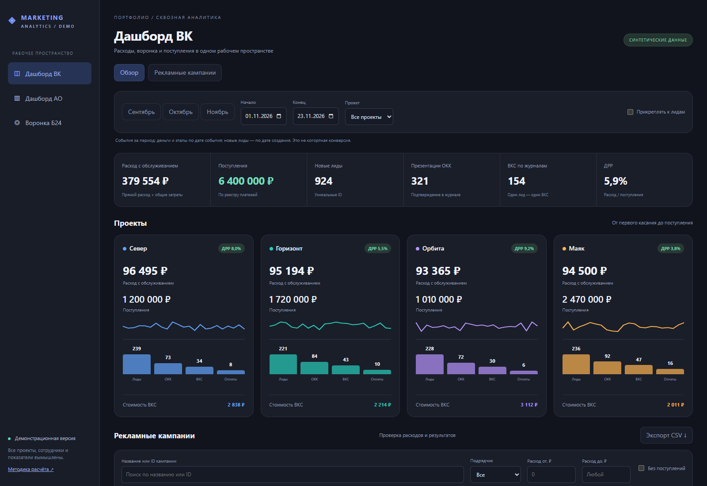
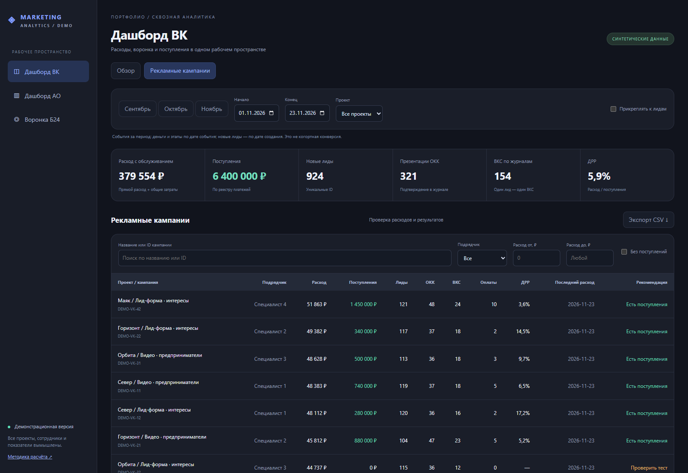
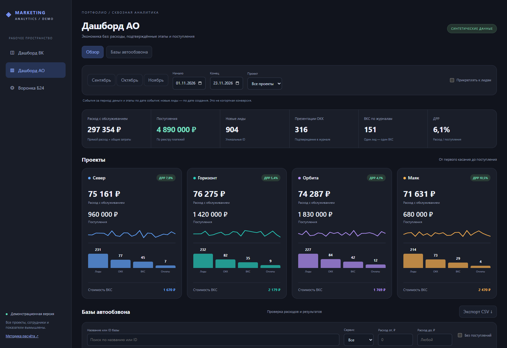
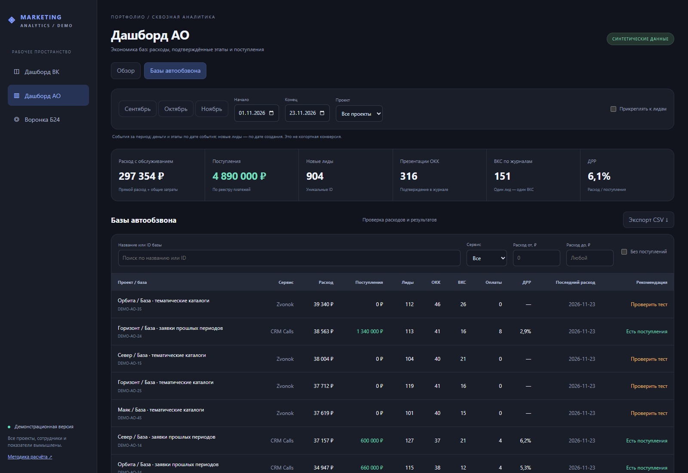
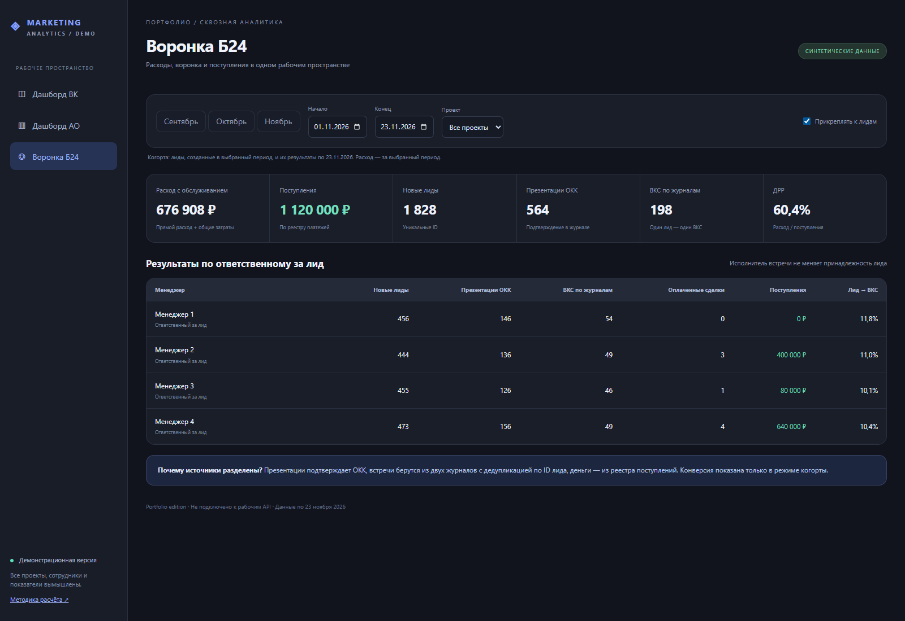
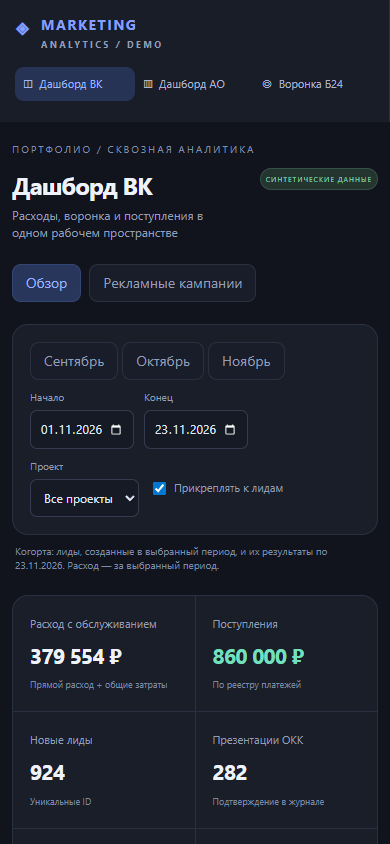

# Marketing Analytics — сквозная аналитика маркетинга

**От рекламного расхода до подтверждённой встречи и поступления денег.**

[Открыть интерактивное демо](https://gilachone.github.io/marketing-analytics-portfolio/) · [Методика](docs/METHODOLOGY.md) · [Архитектура](docs/ARCHITECTURE.md) · [Обезличивание](docs/PRIVACY.md)

> **Публичная портфолио-версия коммерческого проекта.** Все данные демо сгенерированы с нуля: проекты, сотрудники, ID, расходы, воронки и платежи вымышлены. Скриншоты сняты с публичного демо. Рабочие API, клиентские выгрузки и история приватного репозитория не публикуются.



## Задача

Маркетинговые расходы, лиды, проведённые встречи и поступления учитывались в разных системах. Стадия в CRM не всегда отражала реальное проведение встречи, повторные записи в журналах завышали показатели, а календарные платежи смешивались с результатами лидов выбранного месяца.

Проект объединяет эти источники в понятные отчёты: какие кампании и базы дают результат, где бюджет расходуется без поступлений, какие ранее успешные источники стоит проверить для повторного запуска.

## Что реализовано в рабочем проекте

- **VK Реклама:** проекты → рекламные кабинеты → кампании; расходы, поступления, стоимость этапов и ДРР.
- **Автообзвон:** расходы CRM Calls и Zvonok; база обзвона как единица анализа, аналогичная рекламной кампании.
- **Битрикс24:** лиды, источники, ответственные и воронка; отдельные представления по менеджерам.
- **Google Sheets:** презентации с подтверждением ОКК, два журнала ВКС, реестр денежных поступлений.
- **Дедупликация:** один ID лида — одна проведённая ВКС; несколько платежей одной сделки не превращаются в несколько сделок.
- **Атрибуция:** события за период и результаты когорты лидов — два явных режима.
- **Операционный интерфейс:** карточки проектов, фильтры, таблицы со закреплёнными заголовками, CSV, сведения об активности кампаний и контроль качества данных.

Результат — единое рабочее место для разбора маркетинга и сверки факта продаж. Портфолио демонстрирует реализацию и логику, **не заявляет подтверждённую экономию или рост выручки**.

## Что находится в этом репозитории

Это самостоятельная демонстрационная реализация основных экранов и расчётов, а не копия рабочего сервера. Она работает без регистрации, базы данных, API-ключей и внешних запросов.

| В рабочем приложении | В публичной версии |
|---|---|
| Next.js / React / TypeScript, PostgreSQL / Prisma | Компактный браузерный интерфейс на ES modules |
| Фоновые сборщики API и Google Sheets | Детерминированный генератор данных |
| Реальные кабинеты и базы | 4 вымышленных проекта, 24 кампании и базы |
| Авторизация и права доступа | Только безопасное демонстрационное чтение |
| События CRM, журналы и платежи | Синтетические лиды, дубли ВКС и рассрочки |

**В демо работают:** выбор дат и проекта; обзор и детализация; поиск по названию/ID; фильтр сервиса или подрядчика; расход от/до; «без поступлений»; переключение календаря/когорты; CSV; адаптивный интерфейс.

## Экраны

### Кампании ВК

Расход, поступления и воронка рядом с фактической датой последнего расхода. Рекомендация — основание для проверки, а не автоматическое отключение.



### Автообзвон

Та же аналитическая модель, но вместо рекламной кампании — база обзвона. Общие расходы сервиса отделены от прямых.





### Воронка по менеджерам

Результат относится к ответственному за лид. ВКС подтверждается журналами, а не только стадией CRM.



<details><summary>Мобильный интерфейс</summary>



</details>

## Ключевые инженерные решения

1. **Сначала суммы, затем коэффициенты.** ДРР = сумма расходов / сумма поступлений. Среднее процентов строк даёт другой, неверный результат.
2. **Разные источники для разных фактов.** Создание лида — CRM; презентация — ОКК; встреча — журналы; деньги — платёжный реестр.
3. **Разделение календаря и когорты.** Ноябрьская оплата октябрьского лида попадает в календарь ноября и в когорту октября.
4. **Прозрачная неопределённость.** Нет поступлений — ДРР не определён, а не 0%. Нулевая активность не равна подтверждённому отключению.
5. **Ограничения рекомендаций.** Возраст кампании сам по себе не доказывает неэффективность; нужны расход, возраст лидов, этапы, поступления и действующие перезапуски.

## Запуск

Нужен Node.js 20 или новее. Для самого демо зависимости не требуются.

```bash
git clone https://github.com/GilachOne/marketing-analytics-portfolio.git
cd marketing-analytics-portfolio
npm start
```

Открыть **http://127.0.0.1:4173**. Даты демонстрационного набора: **01.09–23.11.2026**.

```bash
npm test       # дедупликация, атрибуция, оплаты, расчёты
npm run check  # проверка публичных файлов на запрещённые артефакты
```

Для пересъёмки скриншотов, при уже запущенном демо:

```bash
npm install --no-save playwright
npx playwright install chromium
node scripts/screenshots.mjs
```

## Структура

```text
src/
  app.mjs          интерфейс, фильтры, экспорт
  data.mjs         воспроизводимые синтетические события
  metrics.mjs      агрегации и атрибуция
  style.css        адаптивная тёмная тема
sql/
  example.sql      пример аналитической модели PostgreSQL
scripts/
  serve.mjs        локальный сервер
  screenshots.mjs снимки и UI-проверки
  privacy-check.mjs проверка содержимого перед публикацией
tests/             тесты расчётов
docs/              архитектура, методика, приватность, скриншоты
```

Публичное демо не предназначено для приёма реальных клиентских данных. Полная серверная реализация, доступы и эксплуатационные конфигурации остаются вне репозитория.
