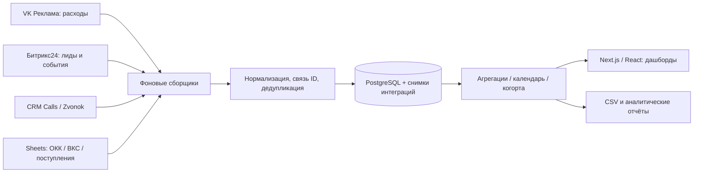

# Архитектура рабочего решения и границы демо

## Рабочий стек

Next.js 15, React 19, TypeScript, Tailwind CSS, Prisma и PostgreSQL, фоновые задачи Node.js, Docker Compose. API-ключи используются на серверной стороне. Доступ к разделам ограничивается ролями. Отдельные сборщики используют снимки данных для отчётов.

Эта схема описывает проект, по которому сделано портфолио. Публичное демо не содержит перечисленных интеграций: генератор → чистые функции агрегации → браузерный интерфейс.

## Контракты

- Лид: ID, дата создания, кампания/база, ответственный.
- Расход: кампания/база, день, прямой расход, доля общих затрат.
- ОКК: ID лида, дата презентации, подтверждение.
- ВКС: ID лида, дата, журнал-источник. Дубли между журналами допустимы на входе.
- Платёж: ID лида и сделки, дата, сумма. Рассрочки остаются отдельными платежами.

Идентификаторы проектов и справочники связываются до агрегации. Изменения названий баз и удалённые базы требуют отдельной проверки: сопоставление только по строке названия не даёт полной гарантии.

## Надёжность аналитики

Суммы сверяются с исходными сервисами; несовпадения не превращаются в нулевые продажи. Разделяются прямые и распределённые расходы. При недоступности источника важно показывать дату последнего обновления, а не выдавать старый снимок за текущий.

`sql/example.sql` — упрощённый аналитический пример, а не миграция рабочей БД. В нём этапы агрегируются до соединения с платежами, чтобы избежать умножения сумм.
